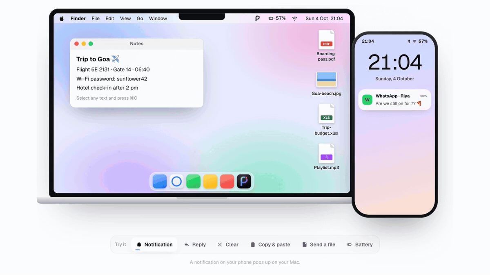
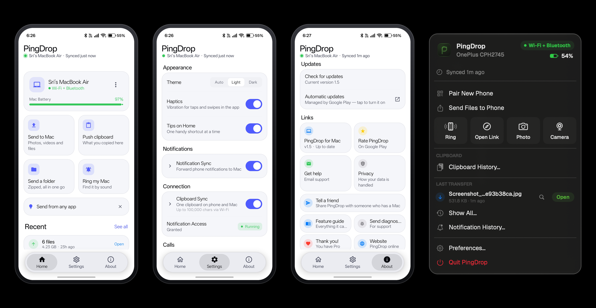

# PingDrop

**Your Android phone, on your Mac.** 
Notifications, clipboard and files — over your own Wi-Fi. No account. No cloud.

  

&nbsp;

&nbsp;

[Website](https://getpingdrop.vercel.app) · [Guide](https://getpingdrop.vercel.app/guide) · [Download](#download) · [PingDrop Pro](#pingdrop-pro) · [Getting started](#getting-started) · [Privacy](#privacy) · [Troubleshooting](#troubleshooting) · [Report a bug](https://github.com/Neerajreddyapi/Pingdrop/issues)

 

▶ <a href="screenshots/demo.mp4">Watch it in HD</a>

> [!NOTE]
> **PingDrop 1.4.4 is out** for the Mac as a signed, notarised `PingDrop.dmg` under
> [Releases](https://github.com/Neerajreddyapi/Pingdrop/releases/latest), and on
> [Google Play](https://play.google.com/store/apps/details?id=com.app.pingdrop). On 1.4.2 or
> later, the Mac app updates itself. Every feature and where to find it:
> [the guide](https://getpingdrop.vercel.app/guide).

## What's new in 1.4.4

- **Your phone gets along with other apps too** — if another app on your phone is using what
  PingDrop needs, your phone now finds another way in and your Mac follows. Messages and files from
  the Mac keep coming over Wi-Fi.

## What's new in 1.4.3

- **Your Mac gets along with other apps** — on a Mac where another app (a local web server, Docker,
  a developer tool) was using what PingDrop needs, Wi-Fi never connected and PingDrop stayed on
  Bluetooth only. It now picks a free way in by itself and tells your phone. File transfers and
  PingDrop Camera too.

## What's new in 1.4.2

- **Calls on your Mac** — see who's calling and answer, decline, silence, mute or end it from a
  card on your Mac, for phone calls and WhatsApp calls. The call's sound stays on your phone. Free.
- **A connection that fixes itself** — after a Wi-Fi drop, the Mac sleeping, or Bluetooth / Wi-Fi
  going off and on, PingDrop reconnects on its own. Works on your phone's hotspot and on Wi-Fi
  without internet.
- **The Mac app updates itself** — new versions install from the menu bar in one click.
- **Clearer pairing** — every step shown on both sides, and a fresh code when one expires.
- **Why it's on Bluetooth only** — both apps tell you, and a Reconnect button on the phone.
- **PingDrop Camera** (Pro) — works in more video apps and keeps going if Wi-Fi blips mid-call.
- **A fresh look** — a glass tab bar and softer buttons on the phone, Liquid Glass across the Mac app.
- **Easier on your Mac's battery** — the Mac stays asleep with the lid closed.

## What's new in 1.4.1

- **Your phone as a webcam** (Pro) — pick **PingDrop Camera** in FaceTime, Zoom, Meet or any
  video app on the Mac. Your phone asks once, then streams over Wi-Fi in 720p, 1080p or 2K.
- **Photo from your phone** (Pro) — click Photo on the Mac, take the shot on your phone, and it
  opens on the Mac.
- **Faster transfers** — up to 4× faster over Wi-Fi, in both directions.
- **Send a folder** — zipped and sent in one go, from the phone or the Mac.
- **Open links on the other side** — Share → Open on Mac on the phone, or Open Link in the
  Mac's menu bar.
- **Share → PingDrop** on the Mac — in Finder's Share menu and every app's Share button.
- **A small 2×1 widget** with your Mac's battery and a Ring button — free.
- **A cleaner Home screen** on the phone, and a tidier menu bar panel on the Mac.

## What's new in 1.4

- **Find my phone** — ring your phone from the Mac's menu bar, loudly, even on silent. And
  **Ring my Mac** from the phone, its widget or a Quick Settings tile. Pick the ring sound on
  each device.
- **Send to Phone from Finder** — right-click files → Quick Actions → Send to Phone with PingDrop.
- **Quick Settings tiles** for Send Clipboard and Ring my Mac — add them from Settings → Shortcuts.
- **Tips** on the Home screen for shortcuts you might not know about.
- On the Mac: an optional **Liquid Glass** look (macOS 26+) and a resizable Preferences window.
- **New in PingDrop Pro:** media controls on the Mac, notification history and search,
  a home-screen widget, and auto-send a folder (like Screenshots) to your Mac.
- A clearer PingDrop Pro screen.

## What's new in 1.3.2

- **A fresh new look** — bolder text, cleaner cards and a true black dark mode.
- Text follows your phone's font and size settings.
- Free transfers are up to 2 GB each, with 3 larger ones free to try. PingDrop Pro sends
  any size.
- A clear sheet shows how many free large transfers you have left.
- Smoother screen transitions.

## What's new in 1.3.1

- **A new look** — the new PingDrop icon on Android (including themed icons) and the Mac,
  where the menu bar now shows the PingDrop mark.
- A redesigned PingDrop Pro screen.
- Pro unlocks or refunds take effect as soon as you reopen the app.

## What's new in 1.3

- **PingDrop Pro** — reply from your Mac, notification rules and quiet hours, calendar
  reminders, clipboard images, custom battery alerts, and choose where files are saved.
  [See all Pro features](#pingdrop-pro).
- Stays connected more reliably and reconnects faster.
- Clipboard history, and update checks for the phone and Mac apps.
- New Home, Sync and Settings tabs.

---

## What it does

> **Every feature, free and Pro, and exactly where to find it on your phone and your Mac:
> [the PingDrop guide →](https://getpingdrop.vercel.app/guide)**

**Notifications on your Mac.** Messages, mail, anything on your phone shows up on
your desktop. You choose which apps are allowed, one by one. Dismiss a notification
on the Mac and it clears on the phone too.

**Clipboard, both ways.** Copy on the Mac, paste on the phone. Copy on the phone and
send it over with one tap — Push clipboard to Mac, the Quick Settings tile, or the share sheet. Each direction has its
own switch.

**Files, both ways.** Drag files onto the PingDrop icon in your menu bar — or right-click
them in Finder → Share → PingDrop — to send them to your phone, or share from any Android
app to your Mac. Transfers show live progress and land in Downloads.

**Your phone as a webcam** (Pro). Pick **PingDrop Camera** in FaceTime, Zoom or Meet and
your phone's camera streams to the Mac over Wi-Fi, in up to 2K.

**Calls on your Mac.** See who's calling and answer, decline or silence it from your Mac —
phone calls and WhatsApp calls. During a call: mute, speaker, volume and end, when your phone
allows it. You still talk on the phone.

**Find my phone.** Ring your phone from the Mac's menu bar — loudly, even on silent —
or ring your Mac from the phone, its widget or a Quick Settings tile.

**Battery at a glance.** Your phone's charge in the Mac menu bar, your Mac's charge in
the phone's notification shade.

**Stays connected.** Wi-Fi when both devices are on the same network (your phone's
hotspot too), Bluetooth LE when they aren't. Fixes itself after Wi-Fi drops, your Mac
sleeping, or Bluetooth and Wi-Fi going off and on — and tells you why when it can't.

**Keeps itself current.** The Mac app updates itself from the menu bar, the Android app
installs its updates from Google Play, and each tells you when the other is out of date.

## Screenshots

  
   
  <b>Home</b> · <b>Sync</b> · <b>Settings</b> on Android &nbsp;—&nbsp; the <b>menu bar panel</b> on the Mac

## Download

| Platform | Get it | Version |
|---|---|---|
| **Android** | [Google Play](https://play.google.com/store/apps/details?id=com.app.pingdrop) |  |
| **Mac** | [PingDrop.dmg](https://github.com/Neerajreddyapi/Pingdrop/releases/latest/download/PingDrop.dmg) from [Releases](https://github.com/Neerajreddyapi/Pingdrop/releases/latest) |  |

PingDrop is free. The Android app shows a small banner ad and, now and then, a full-screen ad
after a transfer. Free transfers are up to 2 GB each, with 3 larger ones to try. A one-time
**[PingDrop Pro](#pingdrop-pro)** purchase removes the ads and the limit — along with unlocking
everything below.

## PingDrop Pro

New in 1.4.1: your phone as a webcam. One purchase in the Android app — no subscription — unlocks Pro on your phone **and**
your Mac.

| | |
|---|---|
| **No ads** | The banner and full-screen ads in the Android app are gone for good. |
| **Any file size** | Send transfers of any size. Free sends are up to 2 GB each, with 3 larger ones to try. |
| **Reply from your Mac** | Answer a message straight from its notification on the Mac. |
| **Notification rules** | Quiet hours, and Normal, Quiet or Priority for each app — Priority always gets through. |
| **Calendar reminders** | Upcoming events from your Mac's calendars, as reminders on your phone. |
| **Clipboard images** | Copy an image on your Mac, paste it on your phone. Send one back with Push clipboard to Mac. |
| **Custom battery alerts** | Up to 10 alerts each — your phone's battery on the Mac, your Mac's on the phone. |
| **Files your way** | Accept transfers automatically and choose where received files are saved, on both sides. |
| **Media controls** | See what's playing on your phone and play, pause or skip from the Mac's menu bar. |
| **Notification history** | Search every notification from the last 30 days, on your Mac. Kept on the Mac only. |
| **Auto-send a folder** | A folder you select, like Screenshots, goes to your Mac automatically, over Wi-Fi. |
| **Home-screen widget** | Your Mac's battery, plus Send files, Clipboard and Ring Mac, on your phone's home screen. |
| **Phone as a webcam** | Your phone's camera as **PingDrop Camera** in FaceTime, Zoom, Meet and other apps, in up to 2K. |
| **Photo from your phone** | Click Photo on the Mac, take it on the phone, and it opens on the Mac. |

## Getting started

1. **On your phone** — install PingDrop from
   [Google Play](https://play.google.com/store/apps/details?id=com.app.pingdrop).
2. **On your Mac** — download `PingDrop.dmg` from
   [Releases](https://github.com/Neerajreddyapi/Pingdrop/releases), open it, and drag
   PingDrop into **Applications**.
3. Open PingDrop on the Mac. It lives in the **menu bar** at the top right, not in the
   Dock.
4. Click the menu bar icon → **Pair New Phone**. A QR code appears.
5. On the phone, tap **Pair with Mac** and scan the code. Allow notification access
   when asked.

Both devices should show **Wi-Fi + BLE** within a few seconds. If only Bluetooth connects,
check that both are on the same Wi-Fi and that PingDrop is switched on in the Mac's System
Settings → Privacy & Security → **Local Network**.

**Phone as a webcam (Pro):** on the Mac, PingDrop **Preferences → PingDrop Camera → Add PingDrop
Camera**, then allow it in System Settings → General → Login Items & Extensions → Camera
Extensions. Pick **PingDrop Camera** in FaceTime (Video menu), Zoom or Meet, and tap **Start** on
your phone. FaceTime's effects — background blur, Studio Light, reactions — work on it too.

**Got a promo code?** On the phone: **Upgrade → Have a promo code?** On the Mac:
**Preferences → PingDrop Pro → Have a promo code?**

## Updating

- **Android** — updates arrive through Google Play, and PingDrop offers to install them
  itself when one is ready.
- **Mac** — from 1.4.2 on, PingDrop updates itself: when a new version is out, the menu bar
  shows **Update to PingDrop …** — one click and it restarts as the new version (or
  **Preferences → Updates → Check for Updates…**). On 1.4.1 or older, download the newest
  `PingDrop.dmg` from [Releases](https://github.com/Neerajreddyapi/Pingdrop/releases) once and
  drag it into **Applications**, replacing the old copy. Your pairing is kept.

## Requirements

| | |
|---|---|
| Mac | macOS 14 Sonoma or later |
| Phone | Android 7.0 or later |
| Network | Same Wi-Fi network, or Bluetooth in range |

## Privacy

PingDrop is built so your data never has to leave your own devices.

- **No account, no server.** Your phone and your Mac talk directly to each other over
  your local network or Bluetooth. There is nothing in between to store or read your
  data.
- **Encrypted end to end.** Pairing exchanges an AES-256 key through the QR code, and
  everything after that is encrypted with it (AES-256-GCM). The key never leaves the
  two devices.
- **The Mac app makes no internet connections at all.**
- **The Android app shows ads** from Google AdMob — a small banner, and now and then a
  full-screen ad after a transfer — which do use the internet. PingDrop never passes your
  notifications, clipboard or files to the ad network. A one-time **PingDrop Pro** purchase
  removes the ads.
- Clipboard items your password manager marks as sensitive are never sent.
- **Calendar reminders (Pro) are off until you turn them on** and allow calendar access
  on your Mac. Events are read on the Mac and sent, encrypted, only to your paired phone.

Full privacy policy: **https://neerajreddyapi.github.io/Pingdrop/privacy-policy.html**

## Troubleshooting

**The phone won't connect.**
Check both devices are on the same Wi-Fi network, Bluetooth is on, and PingDrop is
running on the Mac — look for its icon in the menu bar. Opening PingDrop on the phone
once also wakes it up.

**Notifications stop after a while.**
Some Android phones stop background apps to save battery. If PingDrop shows
**Battery Optimization Active**, tap **Fix** and let it run unrestricted.

**The Mac asks to find devices on your local network.**
Allow it. That is how the Mac reaches your phone — PingDrop only ever talks to the
phone you paired.

**The Mac's Wi-Fi status keeps dropping.**
Check System Settings → Privacy & Security → Local Network and make sure PingDrop is
switched on. Without it the Mac can hear the phone but can't reply.

**PingDrop Camera doesn't show up in Zoom, Meet or FaceTime.**
PingDrop must be in your **Applications** folder. Open its Settings → **PingDrop Camera** →
**Add PingDrop Camera**, then allow it in System Settings → General → Login Items &
Extensions → Camera Extensions. Quit and reopen the video app, and pick **PingDrop Camera**.

**Phone as a webcam: the picture is small, with black sides.**
Hold the phone sideways. Upright, its picture is tall and the video app's frame is wide.

**Can I pair more than one phone?**
One phone per Mac. **Pair New Phone** replaces the current one.

## Support

Found a bug or have an idea? [Open an issue](https://github.com/Neerajreddyapi/Pingdrop/issues)
or email **pingdrop.support@gmail.com**.

PingDrop is free. If it saves you a few trips to your phone, you can support its
development at [Buy Me a Coffee](https://buymeacoffee.com/neerajreddy).

---

© 2026 Neeraj Reddy. All rights reserved. PingDrop is free to download and use;
its source code is not published. Android and Google Play are trademarks of Google LLC.
Mac and macOS are trademarks of Apple Inc.
